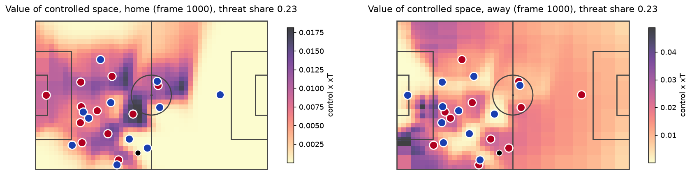
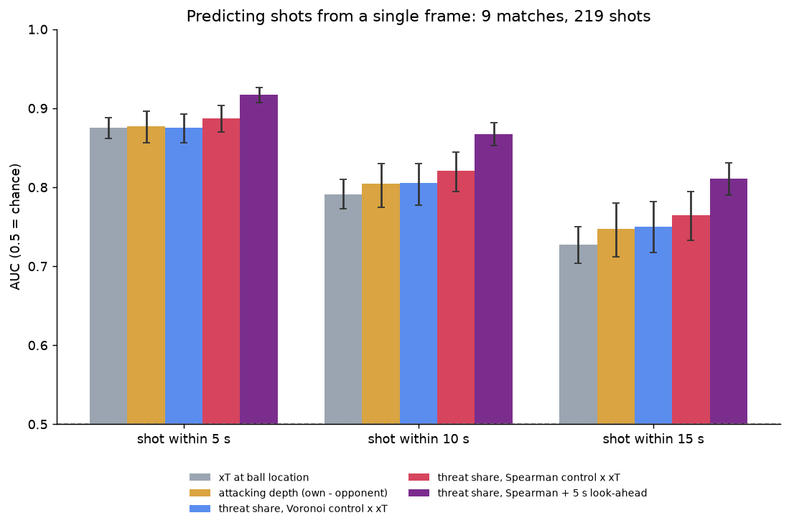
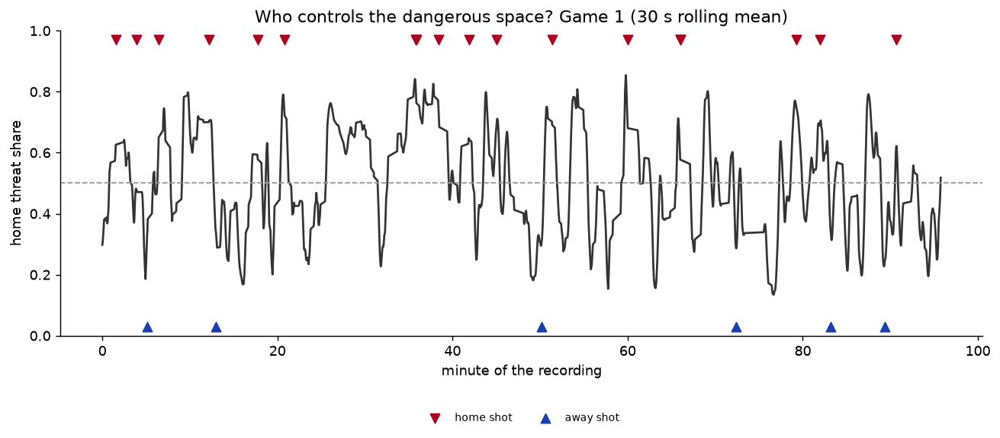
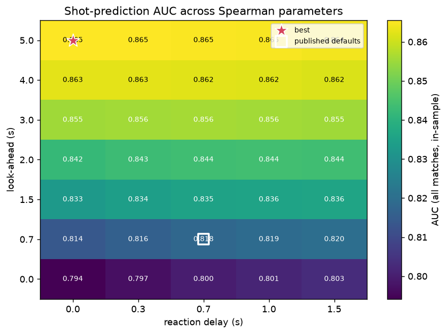

# pitchxt

**Who controls the dangerous space on a football pitch, and does it predict shots?**

`pitchxt` combines two public ideas in football analytics, then tests the combination against simpler baselines on real tracking data:

- **Expected threat (xT)** says how valuable it is for a team to have the ball in each part of the pitch.
- **Pitch control** (Spearman, 2018) says how likely each team is to win the ball in each part of the pitch, given where every player is and how fast they are moving.

Multiplying the two gives the **value of controlled space**: the dangerous areas a team actually holds at a given moment.



*One frame from Metrica sample game 1, computed with the published Spearman parameters. The away team (right panel) controls the space in front of the home goal, which is where threat is highest. Threat share for this frame is 0.23 in favour of the away side.*

## Result

Does a single frame of tracking data say anything about whether a team is about to shoot? For every second of nine matches (two Metrica sample games and seven Bundesliga matches from the DFL open dataset, 219 shots in total), and for each team, I asked whether that team took a shot in the next 5, 10 or 15 seconds. Five indicators are scored by AUC (0.5 is chance, 1.0 is perfect), with 95% intervals from a block bootstrap over 60-second windows.



*Error bars are separate 95% intervals for each score, so they overlap. The paired comparisons below are the more sensitive test.*

| Score | Shot within 5 s | Shot within 10 s | Shot within 15 s |
|---|---|---|---|
| xT at the ball's location | 0.875 (0.862–0.888) | 0.791 (0.772–0.810) | 0.727 (0.704–0.750) |
| Team depth (own minus opponent) | 0.877 (0.856–0.896) | 0.804 (0.774–0.830) | 0.747 (0.712–0.780) |
| Threat share, Voronoi control × xT | 0.875 (0.856–0.893) | 0.805 (0.778–0.830) | 0.750 (0.718–0.782) |
| Threat share, Spearman (published parameters) | 0.887 (0.870–0.903) | 0.821 (0.794–0.845) | 0.764 (0.732–0.795) |
| **Threat share, Spearman with 5 s look-ahead** | **0.917** (0.907–0.926) | **0.868** (0.852–0.882) | **0.811** (0.790–0.831) |

*Team depth is the mean distance of a team's players up the pitch, relative to the opponent's: a deliberately simple baseline with no pitch control at all.*

Paired comparison at 10 s (difference in AUC on the same resampled windows):

| Comparison | Difference | 95% interval |
|---|---|---|
| Spearman with look-ahead vs team depth | +0.063 | +0.047 to +0.081 |
| Spearman with look-ahead vs published Spearman | +0.047 | +0.034 to +0.060 |
| Spearman with look-ahead vs xT at the ball | +0.077 | +0.062 to +0.089 |
| Published Spearman vs team depth | +0.016 | +0.009 to +0.025 |
| Published Spearman vs Voronoi | +0.015 | +0.012 to +0.019 |
| Published Spearman vs xT at the ball | +0.030 | +0.014 to +0.044 |
| Voronoi vs xT at the ball | +0.014 | −0.003 to +0.030 |

The two data sources agree on the ranking. At 10 s, Metrica (48 shots) gives 0.821 / 0.838 / 0.838 / 0.853 / 0.892 and DFL (171 shots) gives 0.783 / 0.795 / 0.796 / 0.812 / 0.861, in the order of the table, and the look-ahead model is best in both sources at every horizon.

**How to read this honestly:**

- Most of the signal comes from where the ball and the players are: simple baselines already reach an AUC of about 0.8 at 10 s. Pitch control adds a small but clear improvement on top (+0.016 over team depth with the published parameters), and a larger one with the look-ahead extension (+0.063).
- Voronoi's advantage over the ball's location is **not** established: its interval touches zero.
- The look-ahead parameter was chosen on these same matches (see below). A cross-validated check, with the parameter chosen without the test matches, gave the same gain, but the cleanest test would be matches the model has never seen.
- This is predictive association at the frame level, not a causal claim. Absolute AUCs should not be compared between the two sources: the DFL data marks when the ball is dead and those frames are excluded, which Metrica cannot do.



*Home threat share through Metrica game 1 (published parameters). Red triangles are home shots, blue are away shots; shots tend to follow spells when the shooting team holds the dangerous space.*

## What the tuning found

Spearman's model has parameters that were set by hand in the original paper. I searched them with match-level cross-validation: parameters are chosen on six matches and judged on the three held out, rotating through all nine.

- Ball speed does not matter at all above about 15 m/s.
- In the published model, one parameter ("reaction time") does two jobs: it delays every player's arrival, and it projects each player forward along their current velocity. Giving each its own parameter showed the data want the **projection**, which I call the *look-ahead*, to be much longer, while the delay hardly matters.
- AUC at 10 s, with a 0.3 s delay, rises with look-ahead (0.797 at 0 s, 0.816 at 0.7 s, the published value, 0.843 at 2 s, 0.863 at 4 s), **peaks at 5 s (0.865)** and falls again (0.859 at 8 s, 0.849 at 10 s). All three cross-validation folds chose 5 s, and the held-out gain over the published parameters was +0.047 (95% interval +0.034 to +0.060).



*In-sample AUC at 10 s over look-ahead and reaction delay, all nine matches.*

A 5 s look-ahead is not a reaction time. It means each player is extrapolated five seconds along their current velocity, so the model weights where players are heading more than where they stand. Forward speed alone is a weak predictor (AUC about 0.74), so it is the combination of position and heading that helps. I therefore treat this as an extension of Spearman's model, not as a measurement of how fast players react.

## How it works

1. **xT** (`xt.py`): a Markov-chain model after Karun Singh, fitted on ~54,000 open-play passes, carries and shots from the 2022 World Cup (StatsBomb open data) on a 16×12 grid. Cell goal rates are shrunk toward the overall rate so cells with few shots stay stable. Penalties and set-piece restarts are excluded. None of the validation matches are in the xT training data.
2. **Pitch control** (`pitch_control.py`): Spearman's time-to-intercept model, vectorised in NumPy. Each player's arrival time depends on their position, velocity, a reaction delay and a 5 m/s top speed, and control is integrated over time until the probabilities sum to one. The published defaults are a 0.7 s reaction time that also sets the look-ahead; the extension sets the look-ahead separately (5 s, with a 0.3 s delay). A full 50×32 surface takes about 0.04 s.
3. **Value of space** (`value.py`): control × xT per cell, measured in each team's own attacking direction. *Threat share* is the home team's value divided by the sum of both teams' values.
4. **Data sources** (`tracking.py`, `dfl.py`, `matches.py`): Metrica sample games 1 and 2 and the seven DFL matches (optical tracking, 25 fps, loaded through kloppy) are converted to one common table: metres, centre-origin, home attacking toward +x. The attacking direction is inferred per match from the goalkeeper's position.
5. **Validation** (`validate.py`, `events.py`): frames are sampled once per second while the ball is in play; for each team, the label is whether it shoots within the next N seconds. Confidence intervals come from resampling 60-second blocks, because neighbouring frames are not independent.
6. **Tuning** (`tune.py`): random and grid searches over the Spearman parameters with match-level cross-validation, plus simple team-movement baselines.

## Status and next steps

Done: xT model, pitch control, validation against four baselines on nine matches, cross-validated parameter search, interactive explorer.

Next:

1. Test the look-ahead model on matches it has never seen, with no further tuning (for example the SkillCorner open data or the PFF 2022 World Cup dataset).
2. Try a graph neural network on the same frames, as a learned alternative to the hand-built threat share.
3. Make the explorer show the look-ahead model.

## Limitations

- Nine matches and 219 shots: enough to separate the models, not enough to say precisely how large each improvement is.
- The look-ahead parameter was selected on the same matches it is evaluated on. Cross-validation suggests this is not inflating the result, but there is no fully external test yet.
- A 5 s look-ahead has no physical interpretation as a reaction time (see above).
- xT is fitted on men's World Cup matches and applied to Bundesliga and Metrica games, so absolute values may not transfer.
- Pitch dimensions for the Metrica data are assumed to be 106 × 68 m. The DFL loader uses the true 105 × 68 m, and the pitch-control grid still uses the 106 × 68 convention, a sub-metre edge effect.
- Dead-ball frames are excluded for the DFL matches only, because Metrica has no dead-ball flag.
- The explorer app still uses the published parameters.
- Metrica sample game 3 uses a different file format and is not supported yet.

## Run it

```bash
python -m venv .venv && source .venv/bin/activate
pip install -r requirements.txt
pip install -e .

git clone --depth 1 https://github.com/metrica-sports/sample-data.git data/raw/metrica

pytest -q
python scripts/make_figures.py                # regenerates everything in docs/
python -m streamlit run app/streamlit_app.py  # interactive explorer
python scripts/validate_all.py                # validation on every available match
python scripts/tune_grid.py lookahead         # parameter grid with cross-validation
python scripts/check_baselines.py             # what pitch control adds beyond simple features
```

### Optional: DFL data

The DFL files are large and not included in the repo. For each match, download its three XML files into `data/raw/dfl/`. For example, for match `J03WPY`:

```bash
mkdir -p data/raw/dfl && cd data/raw/dfl
BASE=https://huggingface.co/datasets/pysport/idsse-data/resolve/main
curl -L -C - -O $BASE/DFL_02_01_matchinformation_DFL-COM-000002_DFL-MAT-J03WPY.xml
curl -L -C - -O $BASE/DFL_03_02_events_raw_DFL-COM-000002_DFL-MAT-J03WPY.xml
curl -L -C - -O $BASE/DFL_04_03_positions_raw_observed_DFL-COM-000002_DFL-MAT-J03WPY.xml
cd ../../..

python scripts/check_dfl.py J03WPY   # sanity checks and a pitch-control picture
```

The seven match ids are `J03WMX`, `J03WN1`, `J03WPY`, `J03WOH`, `J03WQQ`, `J03WOY` and `J03WR9` (the first two use competition code `DFL-COM-000001`, the rest `DFL-COM-000002`). Anything not downloaded is simply skipped.

## Layout

```
src/pitchxt/
  pitch.py          pitch drawing (StatsBomb units and metres)
  data.py           StatsBomb loader with caching
  xt.py             expected threat model
  tracking.py       Metrica tracking loader, velocities, direction handling
  pitch_control.py  Spearman model (with look-ahead option) and Voronoi baseline
  value.py          control × xT and threat share
  events.py         Metrica event loader
  dfl.py            DFL/Sportec open-data loader (via kloppy)
  matches.py        one entry point for loading any match
  validate.py       shot-prediction validation and bootstrap tests
  tune.py           parameter search, cross-validation, simple baselines
app/streamlit_app.py    interactive explorer
scripts/
  make_figures.py       regenerates the figures in docs/
  validate_all.py       validation on every available match
  tune_grid.py          parameter grids with cross-validation
  tune_spearman.py      random parameter search with cross-validation
  check_baselines.py    pitch control vs simple team-movement features
  check_dfl.py          sanity checks for the DFL loader
tests/
```

## References and data

- Spearman, W. (2018). *Beyond Expected Goals*. MIT Sloan Sports Analytics Conference.
- Fernández, J. and Bornn, L. (2018). *Wide Open Spaces*. MIT Sloan Sports Analytics Conference.
- Singh, K. (2019). *Introducing Expected Threat (xT)*.
- Laurie Shaw's *Friends of Tracking* tutorials were a helpful reference for working with Metrica data.
- Event data: [StatsBomb open data](https://github.com/statsbomb/open-data). Tracking and event data: [Metrica Sports sample data](https://github.com/metrica-sports/sample-data).
- Tracking and event data from the Deutsche Fußball Liga (DFL), released under CC BY 4.0: Bassek, M., Rein, R., Weber, H. and Memmert, D. (2025). *An integrated dataset of spatiotemporal and event data in elite soccer*. Scientific Data, 12(1), 195. https://doi.org/10.1038/s41597-025-04505-y. Loaded with [kloppy](https://github.com/PySport/kloppy).